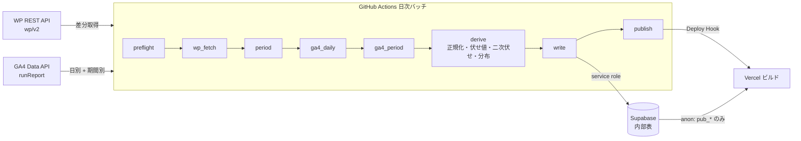

# 03 データパイプライン

- 状態: 草案
- 更新日: 2026-11-03
- 参照: FR-70〜FR-76、NFR-01〜NFR-04、NFR-44、NFR-45、NFR-50〜NFR-52、NFR-61、NFR-70〜NFR-72、D-01〜D-03、D-05〜D-09、D-12、D-15、02_data_model.md、ADR 0001、ADR 0002、ADR 0006、ADR 0007
- 変更履歴:
  - 2026-11-03: 設計レビュー（audits/2026-11-03-design-review.md）の H-1・M-1〜M-8・L-1〜L-10 と Q-36 を反映
  - 2026-11-03: analytics-advisor の画面レビュー（advice/2026-11-03-screens-review.md）と security-auditor の再確認（audits/2026-11-03-design-review-recheck.md）の残りを反映（N-1: 分布 `benchmark_curve` と帯をバッチで計算せず、公開ビューが可視記事から計算する。§1、§6.2、§7）

## 1. 全体の流れ

日次バッチ（GitHub Actions、`apps/batch`、TypeScript）は 1 回の実行で次の工程を順に行う。工程名は `batch_run.failed_step` の値と同じ。

| # | 工程 | 入力 | 出力 | 失敗時 |
| --- | --- | --- | --- | --- |
| 0 | preflight | 環境変数、設定値 | `batch_run` に `running` の行。同じ基準日の `success` が既にあれば何もせず終了（二重実行の防止） | validation |
| 1 | wp_fetch | WP REST API（wp/v2） | `wp_author`、`wp_post`、`wp_category`、`wp_tag`、`wp_post_category`、`wp_post_tag` の upsert と削除 | network / validation |
| 2 | period | 基準日 | `period` の移動窓 6 行の日付更新、月行の追加、`is_confirmed` の更新。今回取り直す期間の集合（§3） | ― |
| 3 | ga4_daily | GA4 Data API | `site_daily`、`site_daily_channel`、`site_daily_device`、`article_daily`（直近 7 日ぶん、またはバックフィル範囲） | quota / auth / network |
| 4 | ga4_period | GA4 Data API | 取り直す期間の `site_period`、`site_period_breakdown`、`site_period_heatmap`、`article_period`（landing_sessions、scroll_count、engagement_seconds）、`article_period_breakdown`。確定した月の `site_month_referrer`、`site_month_city`。30 日が経過した記事の `article_referrer_30d` | 同上 |
| 5 | derive | 内部表（メモリ上の生値を含む） | `article_period.pageviews`、`author_period_breakdown`、`article_summary`（帯の列を除く）、`article_milestone`、`author_summary`（帯の列を除く）、`sns_source_unmapped`。分布 `benchmark_curve` と帯はバッチで計算せず、公開ビューが可視記事から計算する（02 §4.1、N-1） | validation |
| 6 | write | 上記 | Supabase への upsert（1,000 行単位）。移動窓の古い行の削除 | db |
| 7 | publish | ― | Vercel の Deploy Hook を呼び、BI を再ビルドする（ADR 0006）。`batch_run` を `success` に更新 | network |

工程 1〜5 はメモリ上で完結させ、工程 6 でまとめて書く（途中失敗で半端な状態を残しにくくするため。それでも書き込み途中で失敗したときは次回の再実行が同じ基準日で上書きする）。公開（工程 7）は書き込みが成功したときだけ行うので、BI に半端なデータが載らない。

## 2. 実行時刻とトリガー

- `schedule`: `cron: '0 8 * * *'`（UTC 08:00 = JST 17:00、FR-70 の仮置き。Q-13 で T を確定したら合わせる）。GA4 の日次データが揃う JST 15:30 より後、NFR-02 の T = 18:00（仮）より前。
- GitHub の cron は遅延・欠落することがあるため、`cron: '0 9 * * *'`（JST 18:00）にも登録し、preflight で「同じ基準日の success があれば終了」とする。2 回目は保険であり、通常は 1 回目で終わる。
- `workflow_dispatch`: 手動の再実行（FR-70）。入力は `mode`（`daily` / `backfill` / `publish_only`）、`from`、`to`（バックフィル時）。`publish_only` は工程 7（Deploy Hook の呼び出し）だけを行い、除外リストの変更後（ADR 0005）のほか、設定値や辞書（`ui-text.ts`）の変更後の再ビルド、ビルド失敗後の再試行にも使う。public の Actions 実行一覧に見える `publish_only` を除外変更の一意の信号にしないためで、`batch_run` に行を書かない（設計レビュー L-7）。
- 定期実行は main ブランチのワークフローだけが動く（NFR-45 (4)。schedule は既定ブランチでしか動かないが、ジョブ側でも `if: github.ref == 'refs/heads/main'` を付ける）。
- 所要時間の見込み: 通常 2〜4 分（GA4 約 30 リクエスト、WP 約 7 リクエスト、書き込み数万行）。`timeout-minutes: 30`。

## 3. 基準日と期間の決め方

- 基準日 = 実行時刻を Asia/Tokyo に変換した日付の前日（NFR-02）。環境変数 `BASE_DATE` で上書きできる（再実行・試験用）。
- 移動窓: `last7` = [基準日 − 6, 基準日]、`prev7` = [基準日 − 13, 基準日 − 7]。28、90 も同様。
- 月: 2025-10 から基準日の属する月まで。基準日の属する月の `end_date` は基準日。
- 今回「取り直す期間」= 移動窓 6 つ + 基準日の属する月 + 前月（`is_confirmed` がまだ false のとき。月末 + 7 日 ≤ 基準日 で true になり、その実行で最後に取り直して以後は触らない）。それ以前の月は変えない。
- 確定した月の参照元ドメイン・市別（§4.1 行 5）は、その月が `is_confirmed` になった実行で 1 回だけ取得する。行がない確定月があれば（失敗で飛んだ場合）同じ実行で補う。
- 公開後 30 日時点（§4.1 行 10）: `published_on + 29`（30 日目）+ 7 日 ≤ 基準日 かつ `article_summary.referrer_30d_computed_on` が null の記事を対象にする。

## 4. WP REST API からの取得（差分取得、D-03）

事実（親が確認）: `modified` / `modified_gmt` がある、`per_page` 上限 100、`X-WP-Total` / `X-WP-TotalPages` で総数とページ数、`_fields` でネストしたフィールドを指定できる。WP 5.7 以降の `modified_after` パラメータが使えるかは最初の実装で 1 回確認し、使えなければ `orderby=modified&order=desc` で `modified_gmt` が前回実行時刻より新しいものを読み切る。

| 順 | リクエスト | 目的 | 回数 / 日 |
| --- | --- | --- | --- |
| 1 | `GET /wp-json/wp/v2/categories?per_page=100&_fields=id,name,parent` | カテゴリ（二階層、同名の子を `path` で区別） | 1（100 を超えればページング） |
| 2 | `GET /wp-json/wp/v2/tags?per_page=100&_fields=id,name` | タグ | 1〜2 |
| 3 | `GET /wp-json/wp/v2/posts?status=publish&per_page=100&modified_after=<前回成功の started_at − 1 日>&_fields=id,date_gmt,modified_gmt,link,title.rendered,author,categories,tags,content.protected` | 追加・更新された記事 | 1（通常 0〜5 件） |
| 4 | `GET /wp-json/wp/v2/posts?status=publish&per_page=100&_fields=id&page=1..N` | 公開記事の ID 一覧（削除・非公開化の検出） | 3（225 本） |
| 5 | `GET /wp-json/wp/v2/users/<id>?_fields=name,slug,link` | 3 で現れた、まだ slug に解決していない author ID | 0〜数回 |
| 6 | 週 1 回（日曜）: `posts?_fields=id,author` 3 回 + 全著者の `users/<id>` | 表示名・URL の変更を反映 | 週 24 回 |

- 間隔: リクエスト間に 1 秒以上空ける（NFR-72）。`User-Agent` に BI の名前とリポジトリ URL を入れる。失敗は 3 回まで指数バックオフで再試行し、それでも失敗したら `wp_fetch` で失敗にする。
- 処理: `content.protected = true` の記事は取り込まない。既に `wp_post` にあって、今回 (a) ID 一覧にない、または (b) `content.protected = true` になった記事は `wp_post` から削除する（cascade で記事に関する行がすべて消える。FR-72、NFR-34、NFR-52）。
- 著者: `author`（数値 ID）は `users/<id>` で slug・表示名・URL に解決してから捨てる。ID → slug の対応はメモリにだけ持ち、Supabase には置かない（NFR-35）。
- 検証: `link` と著者 `link` が `https://takatsu-connect.com/` で始まることを確認する（FR-04、NFR-91）。違えば validation で失敗にする。
- 初回（バックフィル）は 3 の `modified_after` を付けずに全件を取る（3 回）。
- 固定ページ（`/wp-json/wp/v2/pages`）は Q-17 が未確定のため取得しない。「記事以外」にまとまる。

## 5. GA4 Data API からの取得

- クライアント: `@google-analytics/data` の `BetaAnalyticsDataClient`（v1beta）。認証は google-github-actions/auth が書く資格情報ファイル（`GOOGLE_APPLICATION_CREDENTIALS`）を Application Default Credentials として拾う（ADR 0002）。プロパティは `properties/${GA4_PROPERTY_ID}`。
- `runReport` の規則: `dateRanges` は 1 リクエストに最大 4 つ入れられるので、取り直す期間を 4 つずつまとめる。`limit` は既定 10,000 行、最大 250,000 行（2026-11-03 に公式リファレンスで確認）。行数が 10,000 を超えうる問い合わせ（pagePath × 日）は `limit = 100000` を指定し、`rowCount` が上回れば `offset` でページングする。`returnPropertyQuota: true` を常に付け、`propertyQuota.tokensPerDay.remaining` と `tokensPerHour.remaining`、`tokensPerProjectPerHour.remaining` を `batch_run.counts` に件数として記録する。
- 同時実行はしない（逐次。同時リクエストの割当 10 を使わない）。リクエスト間に 200 ms 空ける。429 / `RESOURCE_EXHAUSTED` は 60 秒待って 1 回だけ再試行し、だめなら `quota` で失敗にする。
- 取得する次元・指標は 03_data_sources.md §2.4 の範囲に限る。`pageReferrer`、`pageLocation`、`pageTitle`、ユーザー系、検索語、`customEvent:*`（D-15 の結論により page_type も）は使わない。

### 5.1 pagePath の正規化（D-05）と page_type（D-15）

規則（`packages/shared/src/page-path.ts`、単体テスト付き）:

1. 小文字化し、前後の空白を除く。
2. クエリ文字列とフラグメントは pagePath には含まれない（GA4 の仕様。`pagePathPlusQueryString` は使わない）。含まれていれば `?` 以降を捨てる。
3. 末尾にスラッシュがなければ付ける。連続するスラッシュは 1 つにする。
4. `^/(\d+)/$` に一致すれば記事 ID。`wp_post` にある ID なら「記事」、なければ「削除済み・未知の記事」（記事単位では格納しない。02_metrics.md §3）。
5. 一致しなければ「記事以外」（トップ `/`、`/category/...`、`/tag/...`、`/author/...`、固定ページ、検索結果、404）。記事単位では格納しない。全体の値は全体の問い合わせ（pagePath なし）から取るので、分類はここでは不要。
6. `/<数字>/<何か>/`（ページ分割 `/4812/2/`、`/4812/amp/`、`/4812/feed/` など）は「記事以外」とする。該当する pagePath が実測で現れるかは未確定（D-05 の残り。親が GA4 で確認し、現れるなら規則 4 を `^/(\d+)/(?:\d+/)?$` に広げるかを決める）。

`/?p=<ID>` 形式は pagePath では `/` になり区別できないが、WordPress は `?p=` をパーマリンクに 301 で転送し GA4 は転送後の URL を記録するため、無視できると見る。

D-15（カスタム次元 `page_type`）: 使わない。理由は (1) 判定は規則 4 で足り、`customEvent:page_type` を次元に足すと行が分割されて pagePath 問い合わせのトークンが増える、(2) 03_data_sources.md §2.4 の取得する次元を増やす必要がある、(3) `page_type = post` でも pagePath が記事 ID でない行（転送前の URL など）の扱いを別に決めることになる。規則 4 を正とする。実装の検証は、バッチに診断の問い合わせを入れずに行う: 初回バックフィルの後、運用担当が GA4 の UI（探索レポート）で「page_type = post の表示回数の合計」を 1 回確認し、`site_daily` から `article_daily` の合計を引いた「記事以外」の値と比べる。差が 1% を超えたら Issue にする（件数だけを書く）。バッチのコードは `customEvent:*` を一切使わない（設計レビュー L-2。§5 本文と 06 §4 の「使わない」と矛盾しないようにした）。

### 5.2 SNS 参照元の正規化（D-02）

規則（`packages/shared/src/sns-source.ts`、単体テスト付き）。`sessionSource` を小文字化し、次の順で判定する。

| 区分 | 完全一致 | 後方一致（`.` を含むドメインの末尾） |
| --- | --- | --- |
| instagram | `l.instagram.com`、`instagram.com`、`ig`、`instagram` | `.instagram.com` |
| facebook | `facebook.com`、`lm.facebook.com`、`l.facebook.com`、`m.facebook.com`、`facebook`、`fb` | `.facebook.com` |
| x | `t.co`、`twitter.com`、`x.com`、`twitter` | `.twitter.com`、`.x.com` |
| line | `line.me`、`lin.ee`、`line`、`timeline.line.me` | `.line.me` |
| other | 上のいずれにも当たらないもの（`threads`、`threads.net` を含む） | ― |

- LINE の値は 2026-11-03 の実測に現れないが、現れたときに拾えるよう規則に入れる。注記（M-11「LINE は実際より少なく見えることがあります」）は維持する。
- 対応づけられなかった Organic Social の参照元は `sns_source_unmapped` に upsert する（ドメイン名を Actions のログには出さない。NFR-44）。運用担当が月 1 回この表を見て、必要なら規則に追加し、コミットで記録する（規則は公開してよい設定。NFR-22 (1)）。
- 流入チャネル（M-10）の正規化: `Organic Search` → `search`、`Organic Social` → `social`、`Direct` → `direct`、`Referral` → `referral`、それ以外（AI Assistant、Email、Organic Video、Unassigned、Paid 系、Cross-network、Display、Affiliates、Audio、SMS、Mobile Push Notifications）→ `other`。「その他」に含めた区分の一覧は画面の注記に出す（05_screens.md、2 回目）。

### 5.3 ユーザー数の期間取得（D-06）

- `activeUsers` は期間単位でだけ取る（日別の合計はしない）。取り直す期間（最大 8 つ）を 4 つずつ `dateRanges` にまとめ、次元なしで `activeUsers` と `userEngagementDuration` を同時に取る（1 期間集合あたり 2 リクエスト）。
- `newVsReturning × activeUsers` も同じまとめ方で 2 リクエスト。`new` / `returning` 以外（空、`(not set)`）は `unknown` に入れる。
- 日別のユーザー数は取得も格納もしない（確定、2026-11-03、Q-35 の (b)）。FR-11 の日別推移で切り替えられるのは読まれた回数と訪問回数の 2 つだけで、読んだ人の数は KPI カード（FR-10）の期間値にだけ出す。05 §4.1 の表は変えない。
- 月ごとの値は `period` の月行ごとに持つので、FR-01 の月別と前年同月も同じ表から引ける。

### 5.4 問い合わせの一覧

「期間集合」= 取り直す期間（通常 8 つ、4 つずつ 2 リクエスト）。「直近 7 日」= `dateRanges: [{startDate: 基準日 − 6, endDate: 基準日}]`。日次の回数は通常日。

| # | 次元 | 指標 | フィルタ | 期間 | 格納先 | 回数 / 日 |
| --- | --- | --- | --- | --- | --- | --- |
| G1 | date | screenPageViews、sessions | ― | 直近 7 日 | site_daily | 1 |
| G2 | date、sessionDefaultChannelGroup | sessions | ― | 直近 7 日 | site_daily_channel | 1 |
| G3 | date、deviceCategory | screenPageViews、sessions | ― | 直近 7 日 | site_daily_device | 1 |
| G4 | date、pagePath | screenPageViews | ― | 直近 7 日 | article_daily | 1（約 2,000 行） |
| G5 | （なし） | activeUsers、userEngagementDuration | ― | 期間集合 | site_period | 2 |
| G6 | newVsReturning | activeUsers | ― | 期間集合 | site_period_breakdown(new_returning) | 2 |
| G7 | sessionSource | sessions | sessionDefaultChannelGroup = Organic Social | 期間集合 | site_period_breakdown(sns) | 2 |
| G8 | dayOfWeek、hour | screenPageViews | ― | 期間集合 | site_period_heatmap | 2 |
| G9 | country、region、city | sessions | ― | 期間集合 | site_period_breakdown(local) に 3 区分へ畳んで格納。確定月は site_month_city（上位 10、Japan、T 以上） | 2 |
| G10 | landingPage | sessions | ― | 期間集合 | article_period.landing_sessions | 2 |
| G11 | pagePath | userEngagementDuration | ― | 期間集合 | article_period.engagement_seconds | 2 |
| G12 | pagePath | eventCount | eventName = scroll | 期間集合 | article_period.scroll_count | 2 |
| G13 | landingPage、sessionDefaultChannelGroup | sessions | ― | 期間集合 | article_period_breakdown(channel)、author_period_breakdown(channel) | 2 |
| G14 | landingPage、sessionSource | sessions | sessionDefaultChannelGroup = Organic Social | 期間集合 | article_period_breakdown(sns)、author_period_breakdown(sns) | 2 |
| G15 | landingPage、deviceCategory | sessions | ― | 期間集合 | article_period_breakdown(device) | 2 |
| G16 | sessionSource | sessions | sessionDefaultChannelGroup = Referral | 確定した月 | site_month_referrer（上位 10、T 以上） | 月 1 |
| G17 | sessionSource | sessions | landingPage = `/<ID>/` かつ sessionDefaultChannelGroup = Referral | 記事の公開日〜30 日目 | article_referrer_30d（上位 3、T 以上） | 記事 1 本につき 1。1 日 0〜2 |
| G18 | （初回対象外） | ― | ― | ― | シェア数（M-41、FR-61）。問い合わせを作らない。実装するときは NFR-39 で 05 §4.1 に行を追加してから `pagePath × eventCount（eventName = AddToAnyShare）` を追加する（設計レビュー M-4） | 0 |
| G19 | sessionDefaultChannelGroup | sessions | ― | 期間集合 | site_period_breakdown(channel)（5 区分に正規化、§5.2。Q-36） | 2 |
| G20 | deviceCategory | screenPageViews、sessions | ― | 期間集合 | site_period_breakdown(device_pv、device_sessions)（Q-36） | 2 |

問い合わせは G1〜G17、G19、G20 の 19 種に限る（G18 は初回対象外）。06 §4 の「問い合わせの種類」はこの一覧を指す。

- G9 の 3 区分: `country = Japan かつ city = Kawasaki` → `kawasaki`、`country = Japan かつ city がそれ以外（(not set) 以外）` → `japan_other`、`country ≠ Japan` または `city` が `(not set)` / 空 → `unknown`（M-14 は「国内」の分母に不明を含めるため、国外も `unknown` に入れる。国外を分けて出す要件はない）。移動窓では市別の行を格納しない（取得はするが 3 区分に畳んでから捨てる）。
- G13・G14 の landingPage は記事 ID に正規化し、記事以外の landingPage は捨てる。著者別は、同じ応答から著者ごとに記事の生値を合算してから伏せる（新たな問い合わせは不要）。
- 著者別の SNS（FR-33）も G14 から。カテゴリ・タグ × 内訳軸 は格納しない（05 §4.1）。

## 6. 集計と伏せ値

### 6.1 伏せ値と二次伏せのアルゴリズム

`packages/shared/src/mask.ts`（単体テスト付き。入力はバケット名と生値の配列、出力は値と `_mask`）。

1. 排他的な区分のすべてのバケットを揃える。GA4 が返さなかったバケットは 0 として格納し、伏せない（0 は個人に結び付かない。D-16 確定、設計レビュー M-1）。
2. `1 ≤ 値 < T` のセルを `threshold` で伏せる（値を null にする）。0 は伏せない。
3. 二次伏せ: 伏せたセルがちょうど 1 つのとき、伏せていないセルのうち **値が T 以上で最小のもの**（同値なら固定の区分順で先のもの）を `secondary` で伏せる。0 と T 未満のセルは候補にしない（候補に入れると、伏せた 2 セルの和 = 合計 − 表示の和 がそのまま伏せた値になり、二次伏せが無効になる。設計レビュー M-1）。該当するセルがなければ追加しない（その場合は区分の合計自体が T 未満であり、記事では合計の `landing_sessions` が伏せられ、サイト全体では現実に起きない）。伏せたセルが 0 または 2 以上のときは何もしない。
4. 曜日 × 時間帯（168 セル）も 1 つの排他的区分として手順 1〜3 を適用する（設計レビュー L-1。復元される値はサイト全体の時間帯 PV で識別性は低いが、アルゴリズムを共通にするコストは小さい）。排他的でない集計（参照元ドメインの上位 N、市別の上位 N、記事 × 期間の単独値）は手順 2 だけ。上位 N は「T 未満の行を落としてから上位 N を取る」。
5. 階層差分（著者 × 内訳軸、設計レビュー M-2）: `author_period_breakdown` の各セル（period_id、axis、bucket）について、同じ period_id・axis・bucket で、その著者の記事セル（`article_period_breakdown`、手順 1〜3 の適用後）のうち伏せたもの（`threshold` または `secondary`）がちょうど 1 本のときは、著者セルを `secondary` で伏せる（値が T 以上でも）。0 本または 2 本以上のときは手順 1〜3 の結果のまま。著者セルへの手順 3 の二次伏せは、手順 5 の後にもう一度判定する（手順 5 で伏せた結果、区分内で伏せたセルが 1 つだけになったら手順 3 を適用する）。入れ子の区分（SNS ⊂ 流入チャネル social、初めて / また来た ⊂ 読んだ人の数、地元 3 区分 ⊂ 訪問回数）は区分内の二次伏せで足りる。

適用先は 05 §4.1 のとおり。合計・累積（記事の期間合計、M-18 の累積、著者・カテゴリ（親・子）・タグ・鮮度区分の合計、公開本数、全体の読まれていた時間の合計、著者 × カテゴリ、著者 × 鮮度区分）は手順 1 の前の生値から計算する。記事の値から合算する集計はすべて除外後（FR-36 の除外は公開ビューが行い、バッチは除外リストを読まない。ADR 0005）。

### 6.2 派生指標の計算

すべてバッチ（TypeScript）が `article_daily` と `wp_post` から計算する。計算式は 02_metrics.md §4.3。

- `article_period.pageviews` = 期間内の `article_daily.pageviews` の合計。
- 累積（M-18）: 公開日を 1 日目として n = 1〜90 の累積。公開前の日に PV があっても（公開日時より前のプレビューなど）累積には含めない。公開ビュー `pub_article_cumulative` は同じ定義を SQL の窓関数で出す。
- 分布（M-19、M-27、`benchmark_curve`）: **バッチは計算しない**（2026-11-03、再確認 N-1）。`internal.benchmark_curve` ビューが可視記事（`excluded_author` に当たらない著者の記事。広告を除く）から計算する（02 §4.1）。定義はビューに移しても変えない: 母集団 = 直近 12 か月（基準日 − 365 日以降）に公開、広告でない、除外著者でない、age_days ≥ n の記事。30 本未満なら全期間に広げる（`population_window = all`）。それでも 30 本未満なら n の行を作らない。分位点は `percentile_cont`（線形補間）。`scope = cat:<id>` は、子カテゴリのうち母集団が 30 本以上のものだけ。`population_size` は可視記事の件数。バッチが除外リストを読まない方針（ADR 0005）を保つため、DB 側で計算する（代替案と推奨は ADR 0003 判断 4 追記）。`packages/shared` の `quantiles()` はビューの結果と突き合わせる参照実装（07 U-07、I-DB-17）。
- 帯（band）: **バッチは計算しない**。公開ビュー `pub_article_summary` が `band_7d`（`pv_7d` を曲線 (all, 7) の p25 / p75 と比べる。age_days ≥ 7 のときだけ）と `band_30d`（N = min(age_days, 30) 日目の累積を曲線 (all, N) と比べる。「◯日目」として同じ日数の帯と比べる。M-20）を、`pub_author_summary` が `band_30d`（`own_median_30d` を曲線 (all, 30) と比べる）を計算する。p75 と等しいときも p25 と等しいときも `middle`。age_days < 3、曲線の行がない、値が null のときは null。`packages/shared` の `band()` は参照実装（07 U-08、I-DB-17）。
- M-22: `is_recent_hot` = age_days ≥ 15 かつ 直近 7 日の PV ≥ 20 かつ 直近 7 日 PV ≥ 2 × (その前 28 日の PV ÷ 4)。`is_revival` = `is_recent_hot` かつ age_days ≥ 91。表示件数の上限（各著者 5、全体 10）は BI 側で `is_recent_hot` の記事を直近 7 日 PV の多い順に切る。
- M-23: 節目（500、1,000、5,000、10,000）を初めて超えた日 = 累積がその値以上になった最初の `day`。`is_evergreen_365` = age_days ≥ 365 かつ 直近 28 日の PV ≥ 20。
- M-24: 著者の記事のうち 直近 12 か月公開・age_days ≥ 30 の `pv_30d` の中央値。該当 5 本未満なら null。
- 削除された記事は `wp_post` から消えているので、どの計算にも入らない。

### 6.3 遅延データと伏せ値（D-08）

- 直近 7 日の日別値と、移動窓・当月・未確定の前月の期間値は毎回まるごと再計算し、同じキーに upsert する。前回の伏せ判定は参照しない（「一度伏せたら伏せ続ける」などの状態は持たない）。
- GA4 の値は遅延データで増える方向にしか変わらないため、再取得で変わる判定は「伏せ → 表示」が主で、「表示 → 伏せ」は移動窓がずれたことによる別のセルの判定である。移動窓の日次差分で日別の内訳が復元されうる点は、粗い排他的区分に限って許容した（ADR 0003 判断 3）。識別性の高い次元は確定した値だけを 1 回格納するので、再取得で変わらない。
- 遅延の最大 7 日を超えて値が変わっても、それ以前の日別値は取り直さない（FR-71 の範囲）。月は `is_confirmed` 後に触らないので、7 日以降の遅延は月の値に反映されない。これは「確定した暦月」の定義（05 §4.1）に沿う。

## 7. 格納

- supabase-js（service role キー）で `upsert`（`onConflict` に PK）。1,000 行ずつ。upsert の前に `period` を更新する（FK のため）。
- 全置換する表（`article_summary`、`author_summary`、`article_milestone`）は、同じ基準日で `delete` → `insert` ではなく、upsert のあと「今回のキー集合にない行を delete」とする（一瞬でも空にならないようにする）。`benchmark_curve` はビューなので書き込みはない（02 §4.1）。
- 移動窓（`period.kind = window`）の期間別行は upsert で上書きされる（キーが固定 ID なので古い日付範囲の行は残らない）。記事が増減した分は「今回のキー集合にない行を delete」で揃える。
- 書き込み件数は `batch_run.counts` に残す。行の内容はログに出さない。

## 8. 公開（キャッシュ更新）

- 工程 7 で Vercel の Deploy Hook（Secrets `VERCEL_DEPLOY_HOOK_URL`）を POST する。呼び方は `curl -fsS -X POST "$VERCEL_DEPLOY_HOOK_URL" -o /dev/null` で、応答本文と URL をログに出さない（設計レビュー L-8。失敗は終了コードで判定し、`error_kind = network`）。Vercel がリポジトリの main をビルドし、ビルド時に `pub_*` ビューを anon キーで読んで全ページを静的生成する（ADR 0006）。
- ビルドが失敗したときは前回のデプロイが残り、`pub_meta.base_date` は進んでいるが画面は古いままになる。Vercel のビルド失敗通知（メール）を運用担当が受ける。BI の FR-02 表示はビルド時の `pub_meta` を埋め込むので、画面の「◯月◯日までのデータ」はその画面が生成された時点の値になる。
- 除外リストの変更後は `workflow_dispatch` の `publish_only` で Deploy Hook だけを呼ぶ（NFR-11）。`publish_only` は設定変更後の再ビルドなど他の用途にも使い、`batch_run` に行を書かない（§2、設計レビュー L-7）。除外変更後は Vercel の旧デプロイを削除する（06 §2.4）。

## 9. 直近 7 日の再取得と再実行

- 毎回、基準日から過去 7 日（基準日を含む 7 日）の日別値を取り直して上書きする（FR-71、NFR-03）。
- 再実行（手動、または 2 本目の cron）は同じ基準日で同じ結果になる（冪等）。`BASE_DATE` を過去日にして実行すると、その日を基準日とした移動窓を上書きするので、通常は使わない（試験用）。
- 失敗した翌日は、前日ぶんも「直近 7 日」に含まれるので日別値は自動で埋まる。期間値も移動窓なので自動で追いつく。欠けうるのは (a) `is_confirmed` になった月の参照元・市別、(b) 30 日が経過した記事の参照元上位 3、で、いずれも「行がない対象を次回に補う」規則（§3）で埋まる。

## 10. 初回バックフィル

`workflow_dispatch` で `mode = backfill`、`from = 2025-10-08`（設定値 `BACKFILL_START`、FR-75）、`to = 基準日`。手順:

1. wp_fetch を全件で実行（3 リクエスト + 著者 21 人）。
2. ga4_daily を 90 日ずつに分割して実行（G1〜G4 を 5 回ずつ。G4 は 90 日 × 300 pagePath ≈ 27,000 行 → `limit = 100000` で 1 リクエスト）。
3. period: 2025-10 以降のすべての月行を作る。
4. ga4_period を「移動窓 6 + 全月（14）」= 20 期間 = 4 つずつ 5 集合で実行（G5〜G15 の各 11 種 × 5 = 55 リクエスト。G13・G14 は 1 期間で 300 記事 × 5 区分 = 1,500 行なので 4 期間で 6,000 行、既定の 10,000 行に収まる）。
5. 確定した全月について G16（14 リクエスト）、G9 の確定月ぶんは手順 4 の応答から上位 10 を取る。
6. 30 日が経過した全記事について G17（約 220 リクエスト）。
7. derive、write、publish。

- 冪等なので失敗したら最初からやり直してよい。長くなる場合は `--phase` で手順 2、4、6 を別々に実行できるようにする。
- 割当: §11 のとおり 1 回で収まる見込みだが、`tokensPerProjectPerHour.remaining` が 2,000 を下回ったら処理を止めて `quota` で終了し、1 時間後に再実行する（G17 が最も多いので、手順 6 は記事 50 本ごとに残量を確認する）。
- 所要時間: リクエスト約 300 × (応答 1 秒 + 間隔 0.2 秒) ≈ 6〜8 分。`timeout-minutes: 60`。
- 2025-11 の不連続な値（03_data_sources.md §2.6）はそのまま取り込む（理由は確認しない）。

## 11. GA4 の割当の見積もり（D-01）

事実（2026-11-03、親が確認）: Core トークン 1 日 200,000、1 時間 40,000、1 プロジェクト × プロパティ 1 時間 14,000。ほとんどのリクエストは 10 トークン以下。

| 区分 | リクエスト数 | 1 リクエストの見込みトークン | 小計 |
| --- | --- | --- | --- |
| 通常日: G1〜G3、G5〜G8、G10〜G12、G19、G20（低カーディナリティ） | 21 | 10 | 210 |
| 通常日: G4、G13〜G15（pagePath / landingPage を含む） | 7 | 30（高カーディナリティ次元の加算を見込む） | 210 |
| 通常日: G9（city、約 250 行 × 4 期間） | 2 | 20 | 40 |
| 通常日: G16、G17（月 1、日 0〜2） | 0〜3 | 10 | 30 |
| 通常日 合計 | 約 34 | | 約 490（1 時間 14,000 の 3.5%、1 日 200,000 の 0.25%）。G18 は初回対象外（M-4）、G19・G20 は Q-36 で追加 |
| バックフィル: ga4_daily（90 日ずつ 5 回） | 20 | 30〜100（G4 は 27,000 行） | 1,000 |
| バックフィル: ga4_period（20 期間を 5 集合） | 65 | 10〜30 | 1,400 |
| バックフィル: G16、G17 | 234 | 10 | 2,400 |
| バックフィル 合計 | 約 320 | | 約 5,200（1 時間 14,000 の 37%） |

- 見込みが 5 倍外れても、通常日は 2,500、バックフィルは 26,000 で、1 日 200,000 に収まる。バックフィルが 1 時間 14,000 を超える場合だけ §10 の残量チェックで分割される。
- 実測は `returnPropertyQuota` の値を `batch_run.counts.ga4_tokens` に記録し、初回のバックフィルと最初の 1 週間で見込みと比べる。見込みの 3 倍を超えたら D-01 を開き直す。
- 同時リクエスト 10、サーバーエラー 1 時間 10 は、逐次実行と再試行 1 回の設計で超えない。

## 12. 60 日停止対策（D-07）

public リポジトリの定期実行は 60 日間リポジトリに活動がないと止まる（親が確認）。対策は 2 段。

1. 止めない: 日次ワークフローとは**別のワークフロー** `.github/workflows/heartbeat.yml` を置く（設計レビュー M-3。日次ワークフロー内のジョブに `contents: write` を置くと、そのジョブで動く依存や Action が侵害されたときに main へコードを push でき、翌日のバッチが service role と WIF の下でそれを実行してしまうため）。
   - トリガー: `schedule`（月 1 回、例: 毎月 1 日 03:00 UTC）と `workflow_dispatch`。main のみ。
   - 権限: ワークフロー全体で `permissions: contents: write` のみ。`id-token` は付けない。
   - 中身: `actions/checkout`（GitHub 製、SHA 固定、`sparse-checkout: ops/`、`fetch-depth: 1`）と `git` CLI だけ。main の最新コミット（`git log -1 --format=%ct`）が 45 日以上前なら `ops/heartbeat.txt` に実行日（UTC の日付）を書き、固定メッセージ（「heartbeat: 定期実行の維持」）でコミット・push する。45 日以内なら何もしない。
   - 置かないもの: `pnpm install`、プロジェクトのコード（`apps/`、`packages/`）、サードパーティ Action、Secrets の参照。
   - 日次ワークフロー（`daily.yml`）は `permissions: contents: read` と、バッチジョブだけの `id-token: write`（06 §9）。
   通常は Dependabot や文書更新のコミットで 45 日以内に活動があり、heartbeat はコミットしない。
2. 止まったことに気づく: BI の FR-02 表示は、ビルド時の `pub_meta.base_date` が前日より古ければ「更新が遅れています」と出す。ただし、ワークフローが止まると再ビルドも起きず、画面は最後のビルドの状態で固まる。そこで BI のクライアント側で「今日の日付 − 表示中の基準日 ≥ 3 日」なら同じ注記を出す（JavaScript で現在日付と比較する。データは読まない）。加えて、運用担当が月 1 回 Actions の実行一覧を確認する手順を docs/operations/ に書く（デプロイ工程）。

Supabase Free は 1 週間アクセスがないと一時停止するが、日次バッチが書き込むので止まらない。バッチが 60 日停止で止まれば 1 週間後に Supabase も止まり、復旧は Supabase の再開 → バッチ再実行の順になる（運用手順に書く）。

## 13. カテゴリ別ヒートマップの可否（D-12）

- 実現方法はある: バッチが G8 と同じ問い合わせに `pagePath` の `inListFilter`（カテゴリに属する記事の pagePath、最大 ...）を付けて期間ごとに取り、T を適用して `category_period_heatmap` に格納し、公開ビューで出す。記事 × 曜日 × 時間帯 は格納しないので、05 §4.1 の「格納しないもの」には触れない。ただし「カテゴリ × 曜日 × 時間帯」は現在「格納しないもの」に明記されているため、実現には NFR-39 の手順（05 §4.1 の表の変更、ADR、security-auditor のレビュー）が要る。
- コスト: 子カテゴリ約 20 × 期間 8 ÷ 4 = 40 リクエスト / 日の追加（約 400 トークン）。`inListFilter` の値の上限（記事数が多いカテゴリで 100 本超）に当たる可能性があり、親カテゴリ 4 つに限るのが現実的。
- 結論: 初回では提供しない（要件のとおり優先度 低）。提供するときは親カテゴリ 4 区分に限り、05 §4.1 に「親カテゴリ × 期間 × 曜日 × 時間帯（伏せ値あり）」の行を追加して NFR-39 の手順を踏む。

## 14. 失敗時の扱いと通知

- どの工程で失敗しても `batch_run` を `failed` にし、`failed_step` と `error_kind` だけを記録する。例外のメッセージとスタックは Actions のログにも出さない（NFR-44。エラーの種別に分類できないものは `unknown`）。
- 未処理例外の既定出力を止める（設計レビュー M-8）: Node は未処理例外のメッセージとスタックを stderr に出し、supabase-js のエラーはプロジェクト URL と表名、GA4 のエラーは `properties/<ID>` を含みうる（Secrets の自動マスクは値の完全一致にしか効かない）。対策は 3 つ。(1) エントリ（`apps/batch/src/main.ts`）で全工程を `try / catch` で囲み、捕まえた例外を `classifyError(e): ErrorKind` で `quota` / `auth` / `network` / `validation` / `db` / `unknown` に分類し、`logError(step, kind)`（種別だけ）を出して終了コード 1 で終える。メッセージ・スタック・例外オブジェクトはどこにも渡さない。(2) `process.on('uncaughtException', ...)` と `process.on('unhandledRejection', ...)` を起動直後に登録し、同じ扱い（分類 → 種別のみ出力 → `process.exit(1)`）にする。(3) `batch_run` への `failed` の書き込みが自体失敗しても、そのエラーも出さず終了コードだけで知らせる。テスト: 07 I-B-11（例外時のログに `https://`、`properties/`、6 桁以上の数字列が出ない）。
- 通知（FR-74）: 通知先は Q-12 で未確定。実装は GitHub Actions の `if: failure()` ステップで、通知先に「ワークフロー名、基準日、失敗した工程、種別、Actions の run URL」だけを送る。Q-12 の回答まではワークフロー失敗時の GitHub のメール通知（リポジトリの管理者に届く）で代える。
- BI は前回の成功時のデータで表示を続ける（NFR-90）。失敗した日は Deploy Hook を呼ばないので画面は変わらず、FR-02 の表示が「更新が遅れています」になる（§12 のクライアント側の判定）。

## 15. ログの規律

Actions のログは誰でも読める（public リポジトリ）。出すのは次だけ（NFR-44、security.md「GitHub Actions」）。

- 工程の開始・終了、所要時間。
- 件数: GA4 リクエスト数と消費トークン、WP リクエスト数、取り込んだ記事数、削除した記事数、書き込んだ行数。
- エラーの種別（§14）。
- 出さないもの: API の応答本文、行データ（記事タイトル、著者名、pagePath、参照元ドメイン、市名を含む）、トークン、プロパティ ID、Supabase の URL とキー、除外リストの内容。環境変数の一覧を出す `env` や `printenv` を使わない。`ACTIONS_STEP_DEBUG` は使わない。
- ロガーは `packages/shared/src/log.ts` に 1 つだけ置き、引数を件数・文字列の種別・所要時間に限った関数（`logCount(step, name, n)` など）だけを公開する。任意のオブジェクトを出す関数を作らない。

## 16. 設定値と環境変数

公開してよい設定（リポジトリ内、`packages/shared/src/config.ts`。変更はコミットで記録。NFR-22 (1)）:

| 名前 | 既定 | 根拠 |
| --- | --- | --- |
| MASK_THRESHOLD | 5 | NFR-33、FR-73 |
| RATIO_MIN_DENOMINATOR | 20 | NFR-96 |
| RECENT_HOT_MIN_PV_7D | 20 | M-22 |
| RECENT_HOT_MIN_AGE_DAYS | 15 | M-22 |
| LONG_AGE_DAYS | 91 | M-21 |
| BENCHMARK_MIN_POPULATION | 30 | M-19 |
| OWN_MEDIAN_MIN_POSTS | 5 | M-24 |
| MILESTONES | 500, 1000, 5000, 10000 | M-23 |
| BACKFILL_START | 2025-10-08 | FR-75、NFR-50 |
| REFETCH_DAYS | 7 | FR-71 |
| CONFIRM_DELAY_DAYS | 7 | 05 §4.1「確定した暦月」 |
| AD_CATEGORY_ID | 188 | Q-08 |
| TOP_N_REFERRER_SITE / TOP_N_CITY / TOP_N_REFERRER_ARTICLE | 10 / 10 / 3 | M-12、M-14 |
| SITE_ORIGIN | https://takatsu-connect.com | FR-04 |
| WP_REQUEST_INTERVAL_MS | 1000 | NFR-72 |

設定値 `MASK_ZERO` は置かない（D-16 確定: 0 は伏せない。切り替え可能にすると「0 を伏せる」設定で二次伏せの候補が崩れるため。設計レビュー M-1）。シェア数（M-41）に関する設定値もない（初回対象外、M-4）。

秘密情報（環境変数。`.env.example` には名前だけ。06 §3）:

| 名前 | 置き場所 | 用途 |
| --- | --- | --- |
| GCP_WORKLOAD_IDENTITY_PROVIDER | Actions Secrets | WIF（initial_setup.md §2） |
| GCP_SERVICE_ACCOUNT | Actions Secrets | 同上 |
| GA4_PROPERTY_ID | Actions Secrets | Data API のプロパティ |
| SUPABASE_URL | Actions Secrets、Vercel 環境変数 | プロジェクト URL |
| SUPABASE_SERVICE_ROLE_KEY | Actions Secrets のみ | 内部表への書き込み |
| SUPABASE_ANON_KEY | Vercel 環境変数のみ（`NEXT_PUBLIC_` を付けない） | ビルド時に `pub_*` を読む |
| VERCEL_DEPLOY_HOOK_URL | Actions Secrets | 再ビルドの起動 |
| NOTIFY_WEBHOOK_URL など | Actions Secrets | 失敗通知（Q-12 の回答後に名前を決める） |
| BASE_DATE | （任意、workflow_dispatch の入力） | 試験・再実行 |

## 17. 未確定

- Q-13: 実行時刻 T（仮 17:00 JST、鮮度 18:00）。cron の遅延を踏まえ、1 回目を 16:30 JST に前倒しする案も依頼者に示す。
- Q-12: 失敗通知の宛先。
- D-05 の残り: `/<ID>/<何か>/` の pagePath が実測で現れるか（親が GA4 で確認）。
- D-03 の残り: `modified_after` が対象サイトの WordPress で使えるか（実装時に 1 回確認。使えなければ §4 の代替）。
- 全体 × 日 × 流入チャネルの「二次伏せ」で、日によっては 5 区分のうち 2〜3 区分が伏さる見込み（other、referral が小さい）。日別推移には内訳を描かず、期間の構成（FR-13、FR-14）は Q-36 で確定した期間値（G19、G20）で出すことで表示上の問題を避ける（05_screens.md §3）。
- D-15 の検証（§5.1）を運用担当が GA4 の UI で行う手順は docs/operations/（デプロイ工程）に書く。

確定した事項（2026-11-03、設計 2 回目と設計レビューの反映で「未確定」から移動）:

- Q-35: (b) 日別のユーザー数は取得も格納もしない。FR-11 の切り替えは読まれた回数と訪問回数の 2 つだけ（§5.3）。
- D-09: `AddToAnyShare` のサービス別は取れない（Data API はカスタム次元として登録したイベントパラメータしか次元として返さず、登録済みの 11 個にシェア先に当たるものがない。03_data_sources.md §2.6）。M-41 は合計（全体・著者）のみ。確定。ただし M-41 自体は初回対象外（設計レビュー M-4。G18 を作らない）。
- Q-36: 全体 × 期間 × 流入チャネル / デバイス を `site_period_breakdown` の axis `channel` / `device_pv` / `device_sessions` として期間ごとに GA4 から取る（G19、G20。§5.4、§11）。二次伏せあり。05 §4.1 への行の追加は requirements-analyst が反映、理由は ADR 0003 判断 6。
- D-16: 0 は伏せない。二次伏せの候補は T 以上の最小セル（§6.1 手順 1・3、設計レビュー M-1）。`MASK_ZERO` は置かない。
- Q-33: 二次伏せを公開しない（ADR 0003 判断 5）。
